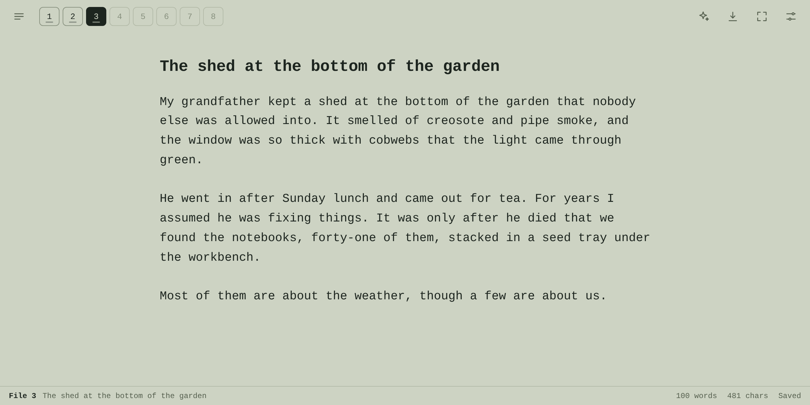

# Slate

Slate is a distraction free writing app in a single HTML file. It is modelled on the AlphaSmart Neo2, the battery powered keyboard with a small LCD screen that let you type and not much else. Slate keeps that idea: a plain page, eight numbered file keys and a status line.

Your writing stays in your browser. There is no account and no server, and nothing leaves your device unless you export a file or ask an AI model for help using your own API key.

Live at: https://jimliddle.github.io/slate-distraction-free-writing/



## Features

- Eight file keys across the top, like the Neo2, plus a searchable library for as many articles as you like
- Saves to your browser's storage as you type
- Exports the current article as Markdown or as a Word document, or every article at once as a zip of Markdown files
- Imports Markdown and plain text files
- LCD, Paper and Night themes, a choice of monospace, serif or sans-serif text, and adjustable text size and line width
- The top bar and status line fade out while you type and come back when you move the mouse
- Starts in full screen if you want it to, and remembers your choice
- Installs as an app on a computer or phone, and can work offline
- An optional assistant that answers questions about your writing, reviews it, reformats it or rewrites it, using Claude, Gemini or ChatGPT with your own key

## Files

| File | What it is |
| --- | --- |
| `slate.html` | The whole app. Open it in a browser and start writing. |
| `sw.js` | Optional. Lets the installed app open without an internet connection. |

## Getting started

The quickest way is to download `slate.html` and open it in your browser. Everything works from a file on your computer except installing it as an app, which needs a web address.

To host it, put `slate.html` and `sw.js` in the same folder on any static web host. On GitHub Pages:

1. Add both files to a repository. If you want Slate at the root of the site, rename `slate.html` to `index.html`.
2. In the repository, open Settings > Pages and publish from your main branch.
3. Visit the address GitHub gives you.

## Installing as an app

When Slate is served over https, browsers will offer to install it. The manifest and icons are built into the HTML file, so there is nothing to set up.

- **Chrome and Edge** on a computer or Android phone: use the install icon in the address bar, or open Settings in Slate and choose Install Slate.
- **Safari on iPhone and iPad:** tap Share, then Add to Home Screen.
- **Safari on a Mac:** choose File > Add to Dock.

If `sw.js` is next to the page, the installed app opens without a connection. It checks the network first, so when you upload a new version the app picks it up the next time it opens online. Without `sw.js`, Slate works the same but needs a connection to open.

## Full screen

Slate starts in full screen by default. Browsers only let a page go full screen after you tap or press a key, so Slate switches on your first keypress or tap, and that keystroke still goes into your text.

The full screen button in the top bar, or Ctrl/⌘+Shift+F, takes you in and out. Slate remembers which you chose last and starts that way next time. You can also change it in Settings.

In Chrome and Edge on a computer, a quick press of Esc closes panels while you're in full screen, and you hold Esc to leave full screen. Safari on iPhone doesn't let web pages go full screen, so the button is hidden there. Adding Slate to your home screen gives you the same clean view.

## Writing and managing articles

The eight buttons along the top are your first eight articles. Click a filled button to open that article, or an empty one to start a new article. On narrow screens the buttons are hidden and you use the library instead. The library button on the left lists every article with its word count and when it was last changed, and has a search box.

Slate saves about half a second after you stop typing, and again when you switch to another tab or app. The status line shows the file number, the title, word and character counts, and whether your latest change has been saved. When you select text it also shows how many words you've selected.

If you leave an article completely empty and open another one, the empty one is removed so blank files don't pile up.

You can import `.md`, `.markdown` and `.txt` files of up to 5 MB each. If a file starts with a `#` heading, that heading becomes the article's title.

## Exporting

The download button in the top bar offers:

- **Markdown (.md)** for the current article, with the title added as a top-level heading
- **Word (.docx)** for the current article
- **All articles (.zip)**, with one Markdown file per article, numbered in file order

You write in plain text, and any Markdown in it is converted to proper formatting when you export to Word. That covers headings, bold, italic, strikethrough, inline code, links, bulleted and numbered lists up to three levels deep, task list checkboxes, block quotes, code blocks and horizontal rules. Word gets three heading levels, so a level 4, 5 or 6 heading comes out as level 3. Tables come through as plain text, and images become links.

## AI assistant

Open the assistant with the sparkle button or Ctrl/⌘+J. If you have text selected it works on that, otherwise it works on the whole article, and you can switch between the two in the panel.

| Action | What it does |
| --- | --- |
| Ask | Answers a question about the text |
| Review | Gives editorial feedback without rewriting anything |
| Reformat | Tidies the text into clean Markdown, or formats it the way you describe, keeping your wording |
| Rewrite | Rewrites the text following your instruction |

Results show up in the panel before anything changes. You can use a Reformat or Rewrite result to replace the selection or the whole article. Any result can be inserted below your text or copied. Ctrl/⌘+Z undoes a replacement.

When you work on a selection, Slate sends the whole article along with it so the model knows what the passage belongs to. The exception is an article longer than 80,000 characters, where only the selection is sent.

Add your keys in Settings under AI keys. You can create them at [console.anthropic.com](https://console.anthropic.com) for Claude, [aistudio.google.com](https://aistudio.google.com) for Gemini and [platform.openai.com](https://platform.openai.com) for ChatGPT. Each provider has a default model that you can change in Settings:

| Provider | Default model |
| --- | --- |
| Claude | `claude-sonnet-5-5` |
| Gemini | `gemini-flash-latest` |
| ChatGPT | `gpt-5.4` |

Providers rename and retire models fairly often. If a request fails with a 404 error, look up the provider's current model list and put the new name in Settings.

Requests go straight from your browser to the provider you picked. Your text and your key aren't sent anywhere else.

## Where your data is kept

Articles and settings live in your browser's IndexedDB storage, in a database called `slate-writer`. Slate asks the browser to treat this storage as persistent so it isn't cleared to free up space, but the browser has the final say. Clearing site data for Slate in your browser settings deletes your articles, so export anything you'd hate to lose.

Storage belongs to one browser on one device. Articles you write on your phone won't appear on your laptop. To move them, export a zip on one device and import the Markdown files on the other.

Under Data in Settings you can export everything, remove your AI keys, or erase everything. Erasing deletes all articles, settings and keys from the browser, and you have to type "erase" to confirm.

## How API keys are protected

Each key is encrypted with AES-GCM before it is saved to local storage. The browser generates the encryption key and marks it as non-extractable, which means no script can read it out, and Slate keeps it in IndexedDB. Your API key is decrypted only at the moment a request is sent, and only goes to its own provider.

Anything that reads local storage on its own, such as a storage viewer, a backup or a sync tool, sees only scrambled data. The encryption can't stop something that runs code inside the page itself, like a malicious browser extension with access to the site, because that code can ask the browser to decrypt the key just as Slate does. The same goes for anyone using your unlocked device. Every web app that keeps API keys in the browser has this limit. Give your keys a spending limit, and revoke a key if you think it has been exposed.

## Security

The page sets a strict Content Security Policy.

- Only the script and stylesheet inside the file can run. Both are pinned by their SHA-256 hash.
- The page can only connect to `api.anthropic.com`, `api.openai.com` and `generativelanguage.googleapis.com`.
- No outside fonts, scripts, images or analytics are loaded.
- Trusted Types are enforced. The only policy allows registering `sw.js` and nothing else.
- Your writing and the AI's responses are always handled as plain text and never inserted as HTML.
- No referrer information is sent with requests.

## Changing the code

The security policy pins the exact contents of the `<script>` and `<style>` blocks. If you edit either one, the page stops running until you update the hashes. Run this in the folder that holds the file after each edit:

```sh
python3 - <<'EOF'
import re, hashlib, base64

path = 'slate.html'
html = open(path, encoding='utf-8').read()
digest = lambda s: base64.b64encode(hashlib.sha256(s.encode('utf-8')).digest()).decode()
style = re.search(r'<style>(.*?)</style>', html, re.S).group(1)
script = re.search(r'<script>(.*?)</script>', html, re.S).group(1)
html = re.sub(r"script-src 'sha256-[^']*'", f"script-src 'sha256-{digest(script)}'", html)
html = re.sub(r"style-src 'sha256-[^']*'", f"style-src 'sha256-{digest(style)}'", html)
open(path, 'w', encoding='utf-8').write(html)
print('Updated hashes in', path)
EOF
```

If you renamed the file to `index.html`, change `path` to match.

If you change what `sw.js` caches, also change the `CACHE` name at the top of it so installed copies throw away the old cache.

## Browser support

Slate is built for current versions of Chrome, Edge, Safari and Firefox, on computers and phones. A few things depend on the browser:

- Holding Esc to leave full screen only works in Chrome and Edge on a computer. In other browsers a single press of Esc leaves full screen.
- Safari on iPhone doesn't support full screen for web pages.
- Installing as an app works best in Chrome, Edge and Safari. Firefox's support for installing web apps is limited.
- Some private browsing modes block IndexedDB. When that happens Slate has nowhere to save your writing, so it locks the page and shows a message explaining why.
